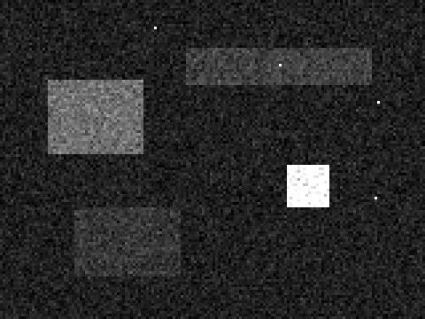
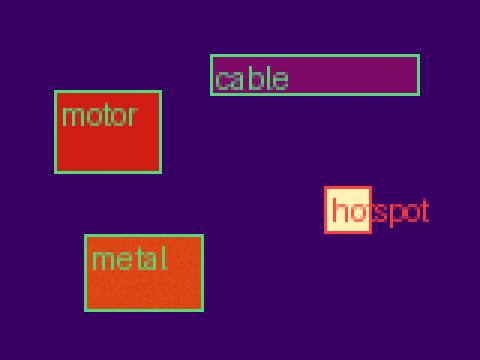

# 热成像流水线演示

在没有机芯的情况下，合成一台 160×120、16 bit 热像仪，跑完这条链：

```text
场景温度
  → 16 bit 原始计数（像素增益/偏移、坏点、探测器漂移）
  → 坏点替换
  → 两点黑体 NUC
  → 快门 FFC 更新偏移
  → 按发射率把辐射量解成温度
  → ROI 最低/最高/平均、等温线、超温告警
```

辐射模型是教学用的 `R(T) ∝ T^4`。真实长波红外要按黑体分段标定，不能直接拿这个公式上设备。

## 场景

| 区域 | 真实温度 | 发射率 | 期望 |
|---|---|---|---|
| 背景 | 28°C | 0.95 | 快门校正后接近真值 |
| 电机 | 62°C | 0.95 | 不高过告警 |
| 线缆 | 44°C | 0.95 | 稳定读数 |
| 热点 | 110°C | 0.95 | 超过 90°C，告警 |
| 金属 | 70°C | 0.25 | 按 0.95 会明显偏低，按 0.25 才接近 70°C |

快门校正期间的那一帧标记为 `ffc`，对外仍发布上一帧温度。

## 运行

```bash
cd /home/ubuntu/WorkSpace/Embedded/thermal-imaging-demo
python3 -m venv .venv
source .venv/bin/activate
pip install -r requirements.txt
python tests/test_pipeline.py
python apps/run_demo.py
python tests/test_recorded_frame.py
python apps/run_recorded_frame.py
bash scripts/ci.sh
```

合成场景的结果写在下面的报告里。完整单页版是 [output/report.html](output/report.html)，数字也在 `output/metrics.json`。

真实帧不用再生成。`data/frame_u16.raw`、`data/bad_pixels.csv` 和 `data/calibration.json` 已经从 FLIR SC660 样张拆好。样张原件是 `data/IR_2412.jpg`（Thermimage 示例，Glenn J. Tattersall）。

## 真实 16 bit 帧

这张 640×480 帧的两点校正和快门校正已经在机芯里做完，原始值是辐射计数值，不是温度。坏点表是外部文件；这张图没有 0 或 65535 的饱和点，所以表是空的。标定文件保存普朗克常数、发射率、反射温度、距离、湿度和大气系数。

参考温度只覆盖像素 (0, 0)：公开换算结果 **23.7344°C**。同一条读取链解出 **23.7344°C**，误差 **-0.00000°C**。把发射率从 0.95 改成 0.50，这个像素变成 **26.97°C**，误差 **+3.24°C**。全图约 22.7°C 到 35.3°C，没有整幅黑体真值，不能把全图误差说成 0。


## 生产路径

设备软件在 `cpp/`。`bash scripts/ci.sh` 会跑 Python 回归和 C++ 生产测试。结果在 `output/production/report.json`。

这次验收用的是合成黑体，不是实验室黑体。35°C 留出点测得 34.96°C，误差 -0.04°C，门限是 ±2°C。真实样张像素 (0, 0) 误差约 0。模拟 3600 秒漂移的最大误差 0.04°C。640×512 查表一帧约 1.6 ms。

发布说明和已知限制在 [RELEASE.md](RELEASE.md)。

## 报告

合成的 160×120、16 bit 机芯。两点黑体做非均匀校正，快门帧更新偏移，再按发射率把辐射量解成温度。金属块真实 70°C、发射率 0.25；全场按 0.95 时读数明显偏低。热点超过 90°C 告警。校正中的帧不发布新温度。

### 测温

| 区域 | 最低 °C | 最高 °C | 平均 °C | 状态 |
|---|---:|---:|---:|---|
| hotspot | 109.8 | 110.2 | 110.0 | 告警 |
| motor | 61.5 | 62.3 | 62.0 | 正常 |
| metal | 68.4 | 71.4 | 70.0 | 正常 |
| cable | 43.6 | 44.5 | 44.0 | 正常 |

### 流水线数字

| 项 | 值 |
|---|---|
| 分辨率 | 160×120 |
| 位深 / 帧率 | 16 bit / 50 fps |
| 原始带宽 | 1.83 MiB/s |
| 640×512@50fps 对照 | 31.2 MiB/s |
| 漂移 | 4000 counts |
| 高发射率平均绝对误差，校正前 | 23.32 °C |
| 高发射率平均绝对误差，快门后 | 0.13 °C |
| 金属真实温度 | 70.0 °C |
| 金属按发射率 0.95 读数 | 38.8 °C |
| 金属按发射率 0.25 读数 | 70.0 °C |
| 快门帧是否发布新温度 | 否 |
| 发布帧标定版本 | 2 |
| 告警阈值 | 90 °C |

### 各阶段

原始计数（百分位拉伸）



只做 NUC，未做快门校正


快门校正后，发射率全按 0.95


快门校正后，使用真实发射率


发布帧：伪彩 + ROI



等温线 60–80°C


## 和面试说法的对应

- 原始带宽按 `宽 × 高 × 2 字节 × 帧率` 算。演示里同时给出 640×512@50fps 的对照值。
- 伪彩不是温度。温度来自校正后的辐射量、发射率和反射温度。
- NUC 用 20°C 和 50°C 两张均匀黑体求每个像素的响应和偏移。
- FFC 只更新偏移。增益表保持不变，标定版本从 1 变成 2。
- 校正中的帧不对外报新温度。
